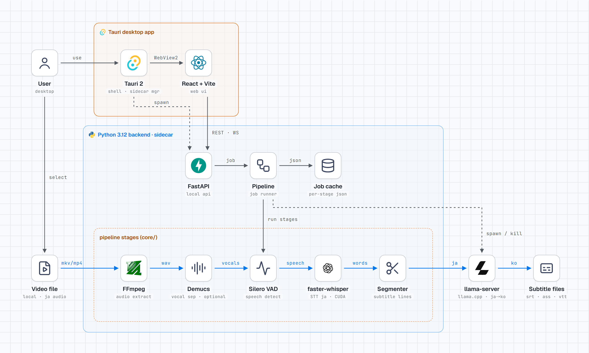

# jamak_converter

일본어 영상(애니메이션·드라마)을 선택하면 **한국어 자막 파일**을 만들어 주는 데스크톱 프로그램입니다.
**기본은 전부 로컬, 클라우드 번역은 선택**입니다. 음성 인식과 번역을 이 PC의 GPU에서 처리하므로 기본 설정에서는 API 비용이 없고 아무것도 외부로 나가지 않습니다.
번역만 Claude, Gemini, OpenAI, DeepL, Papago 같은 클라우드 서비스로 바꿀 수 있습니다. 이때도 나가는 것은 **일본어 대사 텍스트뿐**이고, 영상과 음성은 이 PC를 떠나지 않습니다.

> 상태: Phase 0~5 완료(번역 엔진 선택 포함), 실제 영상 검증(Phase 6)만 남음 · 개발 계획은 [PLAN.md](PLAN.md)를 참고하세요.
> 지원: Windows 10/11 + NVIDIA GPU. **Mac(Apple Silicon, macOS 14 이상) 코드도 들어 있지만 아직 실제 Mac에서 돌려 보지 않았습니다**(아래 [Mac 지원](#mac-지원-apple-silicon-시험-전), TODO.md 4장).



구성도 원본은 [docs/architecture.html](docs/architecture.html)에 있습니다(브라우저에서 열기). 어두운 테마 버전은 [docs/architecture-dark.png](docs/architecture-dark.png)입니다.

---

## 1. 목표와 범위

| 항목 | 결정 |
|---|---|
| 대상 콘텐츠 | 일본어 애니메이션·드라마 (배경음악·효과음이 많고, 고유명사와 말투가 중요함) |
| 처리 방식 | 실시간이 아닌 **파일 단위 일괄 처리** (전체 문맥을 활용해 정확도 우선) |
| 음성 인식 | **로컬** (faster-whisper) |
| 번역 | **로컬** (llama.cpp `llama-server`, 받기는 선택) 또는 번역 프로필로 외부 OpenAI 호환 서버, 클라우드 9곳(Claude, Gemini, OpenAI, DeepSeek, xAI, Mistral, OpenRouter, DeepL, Papago) |
| GUI | Python 로컬 서버 + 웹 UI, **Tauri로 감싼 데스크톱 앱** |
| 결과물 | **자막 파일만** 생성 (SRT / ASS / VTT). 재생은 별도 플레이어에서 함 |

다루지 않는 것(현재 범위 밖): 실시간 번역, 영상에 자막 입히기와 MKV 자막 트랙 넣기, 앱 내 영상 재생.

## 2. 처리 흐름

```
Video ─▶ ① FFmpeg ─▶ ② Demucs ─▶ ③ Silero VAD ─▶ ④ faster-whisper ─▶ ⑤ Segmenter ─▶ ⑥ llama-server ─▶ ⑦ Writer
 mkv/mp4   16k mono    보컬 분리     발화 구간        일본어 STT          자막 단위 분할     일→한 번역           srt/ass/vtt
                       (선택)                        (단어 타임스탬프)
```

| # | 단계 | 기술 | 출력 (작업 캐시) | 비고 |
|---|---|---|---|---|
| ① | 오디오 추출 | FFmpeg | `audio.wav` | 16kHz 모노 PCM. 여러 오디오 트랙이 있으면 일본어 트랙을 고름 |
| ② | 보컬 분리 | Demucs (htdemucs) | `vocals.wav` | 배경음악 때문에 인식이 틀리거나 환각이 생기는 것을 줄임. 옵션이며 기본값은 켬 |
| ③ | 발화 감지 | Silero VAD (faster-whisper 내장) | — | ④ 안에서 함께 실행. 무음·음악 구간을 잘라내 Whisper 환각을 막음 |
| ④ | 음성 인식 | faster-whisper `large-v3` (CUDA fp16), 또는 `large-v3-turbo` · `kotoba-whisper-v2.0` · **Qwen3-ASR 1.7B** | `transcript.json` | 단어 단위 타임스탬프 포함. Qwen은 별도 PyTorch 환경의 작업 프로세스에서 돌고, 단어 시간은 Qwen3-ForcedAligner로 계산 |
| ⑤ | 자막 단위 분할 | 자체 구현 | `segments.ja.json` | 길이·글자 수·쉼 기준으로 다시 나누고 합침 |
| ⑥ | 번역 | llama.cpp `llama-server` (로컬 LLM, GGUF) | `segments.ko.json` | 묶음 단위 번역 + 앞뒤 문맥 + 용어집. 출력은 JSON 스키마로 강제 |
| ⑦ | 자막 쓰기 | pysubs2 | `*.ko.srt` 등 | 영상 파일 옆에 저장 |

### 단계별 캐시

각 단계의 결과는 작업 폴더에 JSON이나 WAV로 저장됩니다. 단계마다 **입력과 설정의 해시**를 기록해 두고, 바뀐 단계부터만 다시 실행합니다.
예를 들어 번역 모델을 바꾸면 ⑥과 ⑦만 다시 돌고, 시간이 오래 걸리는 ②와 ④는 건너뜁니다.

```
%LOCALAPPDATA%/jamak_converter/jobs/<video-hash>/
├─ meta.json            # 원본 경로, 길이, 단계별 설정 해시와 상태
├─ audio.wav
├─ vocals.wav
├─ transcript.json      # 단어 타임스탬프 포함 원문
├─ filtered.json        # 환각 필터가 걸러낸 구간 (디버깅용)
├─ segments.ja.json     # 자막 단위로 나눈 원문
└─ segments.ko.json     # 번역 결과 (사용자 수정 내용 포함)
```

### GPU 메모리 운용 (RTX 4080 16GB 기준)

Whisper large-v3와 14B급 LLM을 **동시에 올리면 VRAM이 부족할 수 있습니다**. 그래서 단계를 순서대로 실행하고, 한 단계가 끝나면 그 모델을 내립니다.

- ②와 ④ 단계가 끝나면 Demucs와 Whisper 모델을 메모리에서 해제합니다.
- ⑥ 단계에서만 `llama-server` 프로세스를 띄웁니다. 번역이 끝나면 프로세스를 종료하므로 GPU 메모리가 확실히 비워집니다.

## 3. 구성 요소

### Tauri 셸 (`app/src-tauri`)
- Tauri 2를 사용합니다. Windows에서는 WebView2로 React UI를 띄웁니다.
- 앱이 시작될 때 Python 백엔드를 **사이드카**로 실행합니다(개발 중에는 `uv run jamak serve`, 배포본에서는 PyInstaller exe). `--port 0`으로 띄워 백엔드가 고른 빈 포트(`JAMAK_LISTENING` 줄)를 읽고, 실행마다 새로 만든 토큰과 함께 `backend_info` 명령으로 UI에 넘깁니다.
- 앱을 닫으면 백엔드를 종료합니다. 앱이 강제 종료되어도 백엔드가 `--parent-pid`로 부모를 지켜보다 스스로 끝나고, llama-server는 Job Object로 묶여 함께 끝납니다(둘 다 확인함).
- `JAMAK_BACKEND_URL`을 지정하면 백엔드를 띄우지 않고 이미 실행 중인 서버에 붙습니다.
- 파일 선택은 Tauri dialog 플러그인으로 합니다. 백엔드에는 **파일 경로만** 넘기고 업로드는 하지 않습니다. 백엔드가 같은 PC에서 파일을 직접 읽습니다.

### 웹 UI (`app/src`)
- React, Vite, TypeScript로 만듭니다.
- 화면은 디자인 캔버스([docs/mockups](docs/mockups), 규칙은 [DESIGN.md](DESIGN.md))를 따릅니다. 왼쪽 사이드바(접기 가능)에 작업(홈 · 진행 중인 작업 · 검수·편집)과 설정(번역 엔진 · 시스템 상태)이 있고, 아래 모니터 줄에 GPU·VRAM·CPU·RAM 사용량이 실시간으로 나옵니다. 색 테마 4종은 시스템 상태 화면에서 바꿉니다.
- 흐름: 홈에서 영상 선택(대화 상자 또는 창에 끌어다 놓기) → 작업 옵션(오디오 트랙, **번역 프로필**, 용어집, STT 모델, 노래 구간, 보컬 분리, 출력 형식) → 진행 → 검수·편집 → 저장.
- 진행 화면은 WebSocket으로 단계별 상태, 전체 진행률, 남은 시간, 로그를 보여 줍니다. 로컬 프로필이면 llama-server 상태를, 클라우드 프로필이면 토큰 사용량과 예상 비용을 표시합니다.
- 검수 화면에서는 줄마다 번역과 시작·끝 시간을 고칠 수 있고, 고친 줄은 잠겨 다시 번역해도 바뀌지 않습니다. 한 자막 글자 수나 초당 15자를 넘는 줄에는 경고가 붙습니다. 고른 줄만 **다른 프로필로** 다시 번역할 수 있습니다(예: 로컬로 번역하고 어려운 줄만 Claude로).
- 클라우드 프로필을 처음 쓸 때 "일본어 대사 텍스트가 전송된다"는 안내를 한 번 확인받고, 옵션 화면에는 같은 문구를 계속 표시합니다.
- 개발 중에는 Tauri 없이 브라우저만으로도 동작해야 합니다. 이때 파일 선택은 경로를 직접 입력하는 방식으로 대신합니다.

### Python 백엔드 (`backend/`)
- Python 3.12를 쓰고 uv로 관리합니다. 시스템에 깔린 3.14는 CTranslate2·PyTorch 휠 호환성 문제가 생길 수 있어 사용하지 않습니다.
- `jamak.core`: 파이프라인 단계. UI와 무관한 순수 라이브러리입니다.
- `jamak.api`: FastAPI 앱. `127.0.0.1`에만 바인딩하고, 작업을 하나씩 순서대로 처리하는 큐를 둡니다(GPU를 하나만 쓰기 때문).
- `jamak.cli`: 같은 core를 쓰는 명령줄 도구. 일괄 처리와 디버깅에 씁니다.

STT와 번역 엔진은 인터페이스 뒤에 숨겨 교체할 수 있게 만듭니다.

```python
class SpeechRecognizer(Protocol):
    def transcribe(self, audio: Path, initial_prompt: str | None, progress, cancel) -> Transcript: ...

class Translator(Protocol):
    def translate(self, lines: list[Line], glossary, progress, cancel, only_ids=None) -> None: ...
```

### 번역 서버: llama.cpp `llama-server`

번역은 llama.cpp의 `llama-server`가 담당합니다. Ollama를 쓰지 않는 이유는 다음과 같습니다.

- **따로 설치할 필요가 없습니다.** Windows용 CUDA 빌드 exe를 앱에 함께 넣어 배포할 수 있습니다.
- **GPU 메모리 관리가 확실합니다.** 백엔드가 번역 단계에서만 프로세스를 띄우고 끝나면 종료하므로, Whisper와 LLM이 GPU 메모리를 순서대로 쓰는 구조가 깔끔하게 지켜집니다.
- **출력 형식을 강하게 제한할 수 있습니다.** JSON 스키마(`response_format`)와 GBNF 문법을 모두 지원합니다.
- **모델 파일을 그대로 씁니다.** Hugging Face의 GGUF 파일을 별도 변환 없이 사용합니다.

실행 방식:

1. 번역 단계가 시작되면 백엔드가 빈 포트를 골라 `llama-server`를 실행합니다. 이때 GGUF 경로, `-ngl 99`(모든 레이어를 GPU에 올림), 컨텍스트 길이, `--host 127.0.0.1`을 인자로 넘깁니다.
2. `/health`가 준비 상태가 될 때까지 기다립니다. 모델을 불러오는 진행 상황은 UI 진행률에 반영합니다.
3. OpenAI 호환 API인 `/v1/chat/completions`로 묶음 번역을 요청합니다.
4. 번역이 끝나거나 오류가 나거나 작업이 취소되면 프로세스를 종료합니다.

번역 클라이언트는 **OpenAI 호환 API 기준**으로 작성합니다(`translate/openai_compat.py`). 그래서 설정에서 "외부 서버" 모드를 고르고 주소를 입력하면, 이미 실행 중인 Ollama, LM Studio, 다른 PC의 `llama-server`도 코드 수정 없이 쓸 수 있습니다.

### 번역 프로필과 클라우드 번역

번역 엔진은 **번역 프로필**(엔진 종류 + 모델 + 키·주소·옵션)로 고릅니다. 프로필을 여러 개 저장하고 하나를 기본으로 지정하며, 작업마다 바꿀 수 있습니다. 처음 실행하면 "로컬 · Gemma 4 12B" 프로필 하나가 기본으로 만들어집니다.

| 종류 | 엔진 | 비고 |
|---|---|---|
| `local_managed` | 내장 llama-server | 번역 단계에서만 띄우고 끝나면 종료 |
| `local_external` | OpenAI 호환 서버 | Ollama, LM Studio, 다른 PC |
| `anthropic` | Claude (`anthropic` SDK) | Opus 5.5 / Sonnet 5.5 / Haiku 5.5. 구조화 출력으로 `[{id, ko}]`를 받고, 시스템 프롬프트와 용어집에 프롬프트 캐싱 적용. Opus·Sonnet 5.5는 서버 측 거절 대체 경로(`fallbacks: "default"`)를 켭니다 |
| `gemini` | Gemini (`google-genai` SDK) | JSON 스키마 응답. 모델 목록은 키로 API에서 가져옴 |
| `openai` · `deepseek` · `xai` · `mistral` · `openrouter` | OpenAI 호환 (`openai_compat.py`) | 주소는 미리 넣어 둠. 모델 목록은 각 서비스의 `/models`에서 가져옴. DeepSeek는 JSON 스키마 대신 `json_object` |
| `deepl` · `papago` | 번역 전용 API (`mt_api.py`) | 줄 단위 번역, 모델·말투 지시 없음. 용어집 단어는 번역 전에 한국어로 바꿔 넣음(DeepL은 `<keep>` 태그로 보존). 사용량은 글자 수. Papago 키는 Client ID + Secret |

서비스 목록은 `core/providers.py` 한곳에 있습니다(이름, 주소, 키 발급·요금 페이지, 키 형식, 요청 차이). 가격은 자주 바뀌어 코드에 넣지 않고, 키 화면에서 각 서비스의 요금 페이지를 엽니다.

- 엔진과 상관없이 프롬프트, 응답 검증(id·줄 수 일치), 실패 시 묶음을 줄여 재시도하는 부분은 공통 모듈(`translate/base.py`)이 처리합니다.
- 클라우드는 묶음을 동시에 보내고(기본 4), 429·5xx는 SDK가 재시도하며, 인증 오류는 바로 멈추고 "키 확인"을 알립니다. 사용 토큰과 예상 비용은 진행 화면과 `meta.json`에 남습니다.
- 서비스가 번역을 거절한 줄은 "거절됨"으로 표시하고, 프로필 설정에 따라 로컬 모델로 다시 번역하거나(기본) 검수 화면에 표시만 합니다.
- 클라우드 프로필에 "이 서비스가 실패하면" 대신 쓸 다른 클라우드 프로필을 지정할 수 있습니다. 한도 초과·인증 오류로 멈추거나 번역에 실패한 줄을 그 프로필로 마저 번역하고 `cloud_fallback`으로 표시합니다.
- 로컬 번역을 받지 않았으면 로컬 프로필은 "준비 안 됨"이 되고, 처음 만든 클라우드 프로필이 기본이 됩니다.
- ⑥ 단계 캐시 해시에는 `종류 + 모델 + 프롬프트 버전 + 번역 옵션`이 들어가고 **API 키는 들어가지 않습니다.** 엔진을 바꾸면 ⑥과 ⑦만 다시 돕니다.

### 설정 저장 (`jamak.db`)과 키 보호

- 설정(API 키, 번역 프로필, 기본 프로필, 화면 설정)은 `%LOCALAPPDATA%\jamak_converter\jamak.db`(SQLite) 한 파일에 저장합니다. 작업 캐시는 지금처럼 `jobs/` 폴더의 파일입니다.
- API 키는 **Windows DPAPI**(현재 사용자 범위)로 암호화해서 저장합니다. Mac에서는 **로그인 키체인**에 넣고 DB에는 `keychain:<임의 id>`만 남깁니다(키를 지우면 키체인 항목도 지움). 저장한 뒤에는 끝 4자리만 볼 수 있고, 키 원문은 로그, 예외 메시지, `meta.json`, 캐시 해시, API 응답 어디에도 넣지 않습니다.
- DPAPI는 DB 파일이 다른 PC나 다른 Windows 사용자에게 넘어가는 경우를 막아 줍니다. 같은 사용자로 실행된 프로그램은 복호화할 수 있다는 한계가 있습니다.
- 개발·CLI용으로 환경 변수(`ANTHROPIC_API_KEY`, `GEMINI_API_KEY`/`GOOGLE_API_KEY`)도 씁니다. 우선순위는 프로필에 연결된 키 → 환경 변수입니다.

```
%LOCALAPPDATA%/jamak_converter/
├─ bin/llama-server/     # llama.cpp Windows CUDA 빌드 (scripts/setup_llama.ps1이 준비)
└─ models/              # *.gguf 번역 모델
```

### API (`jamak serve`)

`127.0.0.1`에만 바인딩합니다. `Host` 헤더가 `127.0.0.1`/`localhost`가 아니면 거부해 DNS 리바인딩을 막습니다. `JAMAK_TOKEN` 환경 변수가 있으면 모든 요청에 `X-Jamak-Token` 헤더(WebSocket은 `?token=`)가 필요합니다. Tauri는 실행할 때마다 임의의 토큰을 만들어 넘깁니다. `--port 0`이면 빈 포트를 골라 `JAMAK_LISTENING http://127.0.0.1:<port>`를 출력하고, `--parent-pid`를 주면 부모 프로세스가 끝날 때 함께 종료합니다.

| 메서드 | 경로 | 설명 |
|---|---|---|
| `GET` | `/health` | 준비 상태 (토큰 없이 허용) |
| `GET` | `/system` | GPU·VRAM, CPU, CUDA, llama-server 빌드, GGUF 목록, STT 모델 목록, 보컬 분리 설치 여부 |
| `GET` | `/system/usage` | 실시간 GPU·VRAM·CPU·RAM 사용량 (하단 모니터) |
| `GET` | `/system/checks` | 점검 카드 목록: GPU, CUDA, 모델, llama-server, 번역 프로필·키, FFmpeg, 저장 공간 |
| `GET` | `/options/default` | 기본 `PipelineOptions` |
| `POST` | `/media/probe` | `{path}` → 길이, 오디오 트랙 목록, 자동 선택될 트랙 |
| `POST` | `/jobs` | `{video_path, options?, force_from?, profile_id?}` → 작업 등록 (GPU 하나라 한 번에 하나씩 처리). 프로필을 안 주면 기본 프로필 |
| `GET` | `/jobs` | 작업 목록 (캐시 폴더 + 실행 중 상태) |
| `GET` | `/jobs/{key}` | 단계별 정보, 옵션, 실행 상태와 최근 이벤트 |
| `WS` | `/jobs/{key}/events` | 진행률·상태 이벤트 스트림 |
| `POST` | `/jobs/{key}/cancel` | 취소 |
| `DELETE` | `/jobs/{key}?purge=true` | 취소, `purge`면 캐시 폴더 삭제 |
| `GET` | `/jobs/{key}/segments` | 자막 줄 목록 + 환각 필터가 걸러낸 구간 |
| `PATCH` | `/jobs/{key}/segments` | `{edits:[{id, ko?, ja?, start?, end?, locked?}]}`. 번역을 고치면 잠금(재번역 시 보존) |
| `POST` | `/jobs/{key}/retranslate` | `{ids, profile_id?}` 고른 줄만 다시 번역. 다른 프로필로도 가능 (명시적 요청이라 잠금 해제) |
| `POST` | `/jobs/{key}/export` | `{output?}` 자막 파일 저장 |
| `POST` | `/fs/reveal` | 탐색기에서 파일 위치 열기 |
| `GET/PUT/DELETE` | `/glossaries[/{name}]` | 작품별 용어집 (별칭, 인식 힌트 표시 포함). `POST /glossaries/import`, `/{name}/export`·`rename`·`duplicate`·`entries`, `GET /glossaries/suggest?filename=` |
| `GET/POST` | `/jobs/{key}/glossary[/attach\|/refresh]` | 작업에 쓴 용어집과 바뀌었는지, 용어집 붙이기, 바뀐 용어집으로 다시 번역 |
| `GET` | `/setup?sizes=` | 받을 수 있는 항목(도구, 실행 환경, 음성 인식 모델, 번역 모델)과 상태, 필요한 항목, 추천 모델, 남은 디스크 |
| `POST` | `/setup/install`, `/setup/remove`, `/setup/cancel` | `{ids}` 받기(필요한 실행 환경을 함께 받음), `{id}` 지우기(다른 모델이 쓰는 항목·마지막 음성 인식 모델은 막음), 멈추기 |
| `GET/POST/DELETE` | `/settings/api-keys[/{id}]` | API 키. 목록에는 `id, provider, label, last4`만. 키 원문은 어떤 응답에도 없음 |
| `GET/POST/PUT/DELETE` | `/settings/translation-profiles[/{id}]` | 번역 프로필 (상태·기본 여부 포함) |
| `POST` | `/settings/translation-profiles/{id}/test` | 짧은 문장 하나를 번역해 키·모델·응답 형식 확인 |
| `PUT` | `/settings/default-profile` | `{profile_id}` 기본 프로필 지정 |
| `GET` | `/settings/models?kind=&key_id=` | 고를 수 있는 모델 목록 (Claude 외에는 키로 각 서비스에 조회) |
| `GET` | `/settings/providers` | 클라우드 서비스 목록 (`core/providers.py`) |
| `POST` | `/settings/api-keys/{id}/check` | 키 확인(모델 목록 조회, DeepL은 이번 달 사용량). 오류 메시지에서도 키는 가림 |
| `POST` | `/system/open-url` | 서비스의 키 발급·요금 페이지를 브라우저로 열기 (목록에 있는 주소만) |
| `GET/PUT` | `/settings/ui` | 색 테마, 사이드바 접힘, 클라우드 안내 확인 여부 |

## 4. 애니·드라마에 맞춘 설계 포인트

- **배경음악과 노래**: Demucs로 보컬을 분리합니다. 오프닝·엔딩곡은 가사를 번역할지 건너뛸지 옵션으로 정합니다.
- **Whisper 환각**: VAD를 쓰고 `condition_on_previous_text=False`로 설정합니다. 같은 문장이 반복되거나 "ご視聴ありがとうございました" 같은 알려진 환각 문구가 나오면 걸러냅니다.
- **고유명사**: 작품별 **용어집**(`glossary.json`, 일본어 표기 → 한국어 표기)을 Whisper의 `initial_prompt`(인식 힌트)와 번역 프롬프트 양쪽에 넣습니다.
- **말투**: 번역 프롬프트에 "자연스러운 구어체 한국어 자막, 원문의 존댓말·반말 유지, 의역 허용, 한 줄 길이 제한" 규칙을 둡니다.
- **문맥**: 앞에서 번역한 몇 줄을 문맥으로 함께 넘겨 주어가 생략된 문장도 이어지게 번역합니다.
- **줄 맞춤 보장**: 번역 결과는 `[{id, ko}]` 형태의 JSON으로 받습니다(`response_format`에 JSON 스키마 지정, 필요하면 GBNF 문법으로 더 엄격하게 제한). 줄 수나 id가 맞지 않으면 묶음 크기를 줄여 다시 시도합니다.

## 5. 출력

영상 파일과 같은 폴더에 같은 이름으로 저장하므로, 대부분의 플레이어가 자막을 자동으로 불러옵니다.

```
episode01.mkv
episode01.ko.srt        # 한국어 (기본)
episode01.ja.srt        # 일본어 원문 (옵션)
episode01.ja-ko.ass     # 이중 자막: 위 원문, 아래 번역 (옵션)
```

## 6. 개발 환경

| 도구 | 용도 | 이 PC 상태 (2026-11-24) |
|---|---|---|
| NVIDIA GPU + 드라이버 | CUDA 추론 | RTX 4080 16GB, 드라이버 621.24 ✅ |
| FFmpeg | 오디오 추출 | 8.1 ✅ |
| uv | Python 3.12 가상환경과 의존성 관리 | 0.12.22 ✅ |
| Node.js + pnpm | 프런트엔드 | Node 24 / pnpm 11 ✅ |
| Rust (rustup) + MSVC | Tauri 빌드 (개발 PC에만 필요) | rustc 1.100.0 stable-msvc, VS Build Tools 2026 ✅ |
| llama.cpp `llama-server` | 로컬 LLM 서버 (Windows CUDA 빌드) | **자동 준비**: `scripts/setup_llama.ps1` (설치 불필요) |
| GGUF 번역 모델 | 일→한 번역 | ❌ 내려받기 필요 (Phase 0에서 잠정 모델 1개, Phase 6에서 확정) |

CUDA 런타임은 시스템에 따로 설치하지 않습니다.
- Python 쪽(faster-whisper)은 pip 패키지(`nvidia-cublas-cu12`, `nvidia-cudnn-cu12`)로 가상환경 안에 넣습니다.
- `llama-server` 쪽은 llama.cpp 릴리스의 `cudart` DLL을 실행 파일 옆에 둡니다. 둘은 서로 다른 프로세스라 충돌하지 않습니다.

### llama-server 준비

```powershell
powershell -ExecutionPolicy Bypass -File scripts\setup_llama.ps1
```

- 고정된 빌드(현재 `b12675`, CUDA 12.4)의 `llama-server.exe`와 CUDA 런타임 DLL을 GitHub 릴리스에서 받습니다. 받는 양은 약 750MB이고, 풀면 약 1.4GB입니다. llama.cpp의 다른 도구까지 들어 있기 때문이며, 배포할 때는 필요한 파일만 남깁니다.
- GitHub가 공개한 SHA-256 값과 비교해 파일이 온전한지 확인합니다.
- `%LOCALAPPDATA%\jamak_converter\bin\llama-server\`에 풀고, 빌드 정보를 `version.json`에 기록합니다.
- 마지막으로 `--list-devices`를 실행해 GPU가 인식되는지 확인합니다.
- 같은 빌드가 이미 있으면 아무것도 하지 않습니다. 옵션:

| 옵션 | 설명 |
|---|---|
| `-Build b12700` | 다른 빌드로 바꿈. 바꾼 뒤에는 PLAN.md Phase 0의 확인 항목을 다시 실행 |
| `-Cuda 13.5` | CUDA 13 빌드 사용. 최신 드라이버가 필요 |
| `-Dest <경로>` | 설치 위치 변경 |
| `-Force` | 같은 빌드라도 다시 받음 |

관리자 권한, PATH 등록, 서비스 등록은 필요 없습니다. 지우려면 폴더를 삭제하면 됩니다.

### 설치 파일 만들기

```powershell
powershell -ExecutionPolicy Bypass -File scripts\build_app.ps1
# → app\src-tauri\target\release\bundle\nsis\jamak_0.1.0_x64-setup.exe (약 80MB)
```

Mac(Apple Silicon)에서는 `scripts/build_app.sh`가 `.app`과 `.dmg`를 만듭니다(서명 전이라 처음 열 때 우클릭 › 열기).

설치한 앱을 처음 열면 내려받기 화면이 나옵니다. 꼭 필요한 것은 FFmpeg와 음성 인식 모델 하나뿐입니다(그래픽카드 메모리에 맞춰 하나를 미리 고름. large-v3면 CUDA 포함 약 4.4GB). 로컬 번역(llama-server + Gemma 4 12B, 약 7.7GB)은 선택이고, 받지 않으면 클라우드 번역 키를 등록하도록 안내합니다. 나머지는 **설정 › 모델 관리**에서 언제든 받거나 지웁니다. 모두 `%LOCALAPPDATA%\jamak_converter\`에 저장합니다.

| 항목 | 받는 크기 | 언제 |
|---|---|---|
| FFmpeg | 0.08GB | 항상 |
| CUDA 라이브러리 | 1.25GB | Whisper 계열을 GPU로 쓸 때 |
| Whisper large-v3 / large-v3-turbo / kotoba-whisper-v2.0 | 3.1 / 1.6 / 1.5GB | 고른 모델만 |
| Qwen3-ASR 1.7B + ForcedAligner | 6.2GB | Qwen을 고를 때 |
| PyTorch 실행 환경 | 약 2.7GB (설치 후 4.5GB) | Qwen을 고르면 같이 받음. uv로 Python 3.12 환경을 만들고 해시가 고정된 목록(`runtime/qwen-requirements.lock`)으로 설치 |
| llama-server + Gemma 4 12B | 0.7 + 7.0GB | 로컬 번역을 쓸 때 (기본 번역 모델) |
| 다른 번역 모델 (GGUF) | Qwen3.5 9B 5.7GB · Gemma 4 26B A4B 14.4GB · Mistral Small 3.2 24B 14.3GB · Qwen3.5 35B A3B 22.0GB | 고른 모델만. 받은 모델은 로컬 프로필에서 고름. Gemma 4 12B 외에는 아직 번역 비교 전(Phase 6) |

### 실행

```powershell
# 번역 서버 준비 (처음 한 번)
powershell -ExecutionPolicy Bypass -File scripts\setup_llama.ps1

# 백엔드
cd backend
uv sync                                              # 기본 설치
uv sync --extra separation                           # (선택) 보컬 분리 Demucs + PyTorch, 약 2.5GB
uv run jamak doctor                                  # ffmpeg, CUDA, llama-server, 모델 확인
uv run jamak transcribe "D:\video\episode01.mkv"   # CLI
uv run jamak serve --port 8765                      # API 서버

# 프런트엔드 + Tauri (백엔드를 알아서 띄움)
cd app
pnpm install
pnpm tauri dev

# 브라우저만으로 UI 개발: 백엔드를 8765 포트로 따로 띄운 뒤
pnpm dev                                             # http://localhost:5173 (영상 경로는 직접 입력)
```

번역 모델은 `%LOCALAPPDATA%\jamak_converter\models\`에 GGUF 파일을 두면 됩니다. 잠정 기본값은 Google 공식 [`gemma-4-12b-it-qat-q4_0.gguf`](https://huggingface.co/google/gemma-4-12B-it-qat-q4_0-gguf)(7GB, Apache 2.0)입니다. 음성 인식 모델은 작업 중에 몰래 받지 않습니다. 받지 않은 모델로 작업을 만들면 409와 함께 "모델 관리에서 받으세요"를 돌려줍니다.

#### CLI 주요 옵션

| 옵션 | 설명 |
|---|---|
| `--glossary 파일` | 용어집. `.txt`(한 줄에 `ユウキ=유키`) 또는 `.json`(`[{"ja","ko","note"}]`). 인식 힌트와 번역에 모두 반영 |
| `--formats srt,ass,vtt` | 출력 형식 (기본 `srt`) |
| `--ja` / `--dual` | 일본어 자막도 저장 / 일본어+한국어 이중 ASS 저장 |
| `--separate` | Demucs 보컬 분리 사용 (`--extra separation` 설치 필요) |
| `--song 0:00-1:30` | 오프닝·엔딩 노래 구간 (여러 번 지정 가능). `--song-mode skip`이면 그 구간 대사를 버리고, 기본(`translate`)은 ♪ 표시와 함께 번역 |
| `--stt-model 이름` | `large-v3`(기본) / `large-v3-turbo` / `kotoba-whisper-v2.0` / `qwen3-asr-1.7b` (받아 둔 모델만) |
| `--parallel N` | 번역 묶음 N개 동시 처리 |
| `--llm-model 경로` | 다른 GGUF 사용 |
| `--llm-url URL` | 외부 OpenAI 호환 서버 사용 (예: Ollama `http://127.0.0.1:11434/v1`) |
| `--profile 이름` | 저장한 번역 프로필 사용 (없으면 기본 프로필. `--llm-*` 옵션을 주면 그쪽이 우선) |
| `--force 단계` | 캐시가 있어도 해당 단계부터 다시 실행 |
| `--out 폴더` | 출력 폴더 (기본: 영상 옆) |

#### 키와 번역 프로필 (CLI)

```powershell
uv run jamak keys add anthropic --label 개인    # 키는 화면에 보이지 않게 입력 (getpass)
uv run jamak keys list                          # id, 제공자, 이름, ••••끝 4자리
uv run jamak profiles add "Claude Opus" anthropic --model claude-opus-5-5 --key 1
uv run jamak profiles test "Claude Opus"        # 문장 하나로 키·모델·응답 형식 확인
uv run jamak profiles set-default "Claude Opus"
uv run jamak profiles list
```

#### 테스트

```powershell
cd backend
uv run pytest            # 단위 테스트 (GPU 불필요)
uv run pytest -m gpu -s  # 끝까지 실행하는 테스트 (CUDA, Whisper, llama-server 필요)
uv run pytest -m mlx -s  # Mac 전용: 진짜 mlx-whisper(whisper-tiny 75MB를 받음). CI의 Mac 러너에서도 실행
```

테스트용 영상은 저작권 문제가 없도록 Open JTalk(`pyopenjtalk`)로 일본어 대사를 합성해 자동으로 만듭니다(`tests/fixtures_gen.py`). 트랙이 두 개인 MKV(영어 무음 + 일본어 대사 + 배경음)라서 트랙 선택, 발화 감지, 인식, 번역을 한 번에 확인할 수 있습니다.

### Mac 지원 (Apple Silicon, 시험 전)

Mac에는 NVIDIA GPU가 없으므로 Apple GPU(Metal)를 씁니다. 단위 테스트는 가짜 mlx-whisper·키체인으로 Windows에서도 돌고, 음성 인식 연결부는 GitHub의 Mac 러너에서 진짜 mlx-whisper(whisper-tiny)로 확인합니다. 다만 **실제 Mac에서 앱을 띄워 영상을 처리해 보지는 않았습니다.** Intel Mac은 대상이 아닙니다.

| | Windows | Mac (Apple Silicon) |
|---|---|---|
| 음성 인식 | faster-whisper (CUDA) | **mlx-whisper** (Metal). 같은 모델 id, MLX 변환본. 빔 서치 없음, Silero VAD 구간을 `clip_timestamps`로 넘김, 같은 구간의 인코더 결과는 재사용 |
| Qwen3-ASR | PyTorch 실행 환경 | 목록에서 숨김 (MPS 시험 전) |
| CUDA 라이브러리 | 받음 | 필요 없음 |
| 번역 | llama-server CUDA 빌드 | llama-server **Metal** 빌드 (`macos-arm64.tar.gz`, 17MB) |
| FFmpeg | BtbN LGPL | martin-riedl.de 서명 빌드 (해시 고정) |
| 모델 메모리 | VRAM | 통합 메모리의 약 70% (Metal이 GPU에 주는 몫) |
| API 키 | DPAPI | 키체인 |
| 데이터 폴더 | `%LOCALAPPDATA%\jamak_converter` | `~/Library/Application Support/jamak_converter` |
| 앱 | NSIS 설치 파일 | `.app` / `.dmg` (서명·공증 전) |

인식 결과 캐시에는 엔진 이름이 들어가므로 Windows와 Mac의 결과가 섞이지 않습니다. 실제 Mac에서 확인할 것은 TODO.md 4장에 있습니다.

## 7. 폴더 구조

```
jamak_converter/
├─ backend/                 # Python 3.12 (uv)
│  ├─ pyproject.toml
│  ├─ src/jamak/
│  │  ├─ core/
│  │  │  ├─ audio.py        # ffmpeg 추출, 트랙 선택
│  │  │  ├─ separate.py     # Demucs
│  │  │  ├─ filters.py      # Whisper 환각 필터
│  │  │  ├─ proc.py         # 자식 프로세스 수명 관리 (Windows Job Object, Mac은 종료 시 정리)
│  │  │  ├─ stt/            # base.py, faster_whisper.py, mlx_whisper.py(Mac), qwen_asr.py (작업 프로세스를 띄우는 쪽)
│  │  │  ├─ glossary.py     # 용어집 파일 (v2: 별칭, 인식 힌트), 가져오기·내보내기, 합치기
│  │  │  ├─ providers.py    # 클라우드 번역 서비스 목록
│  │  │  ├─ segmenter.py
│  │  │  ├─ translate/      # base.py(공통 묶음 번역), openai_compat.py, llama_server.py,
│  │  │  │                  # anthropic_api.py, gemini_api.py, mt_api.py(DeepL·Papago), factory.py, prompts.py
│  │  │  ├─ store.py        # 설정 DB (jamak.db, SQLite)
│  │  │  ├─ secrets.py      # API 키 보호 (Windows DPAPI, macOS 키체인)
│  │  │  ├─ subtitle.py     # SRT/ASS/VTT 쓰기
│  │  │  ├─ cache.py        # 단계 해시와 작업 폴더 관리
│  │  │  └─ pipeline.py
│  │  ├─ api/               # server.py (FastAPI, WebSocket), jobs.py (작업 큐), checks.py (시스템 점검·사용량)
│  │  ├─ hw.py              # 플랫폼·GPU 확인 (NVIDIA VRAM, Apple 통합 메모리)
│  │  ├─ models.py          # 받을 수 있는 항목 목록 (크기, VRAM, 필요한 실행 환경, Windows·Mac별)
│  │  ├─ installer.py       # 받기·지우기 (FFmpeg, CUDA DLL, PyTorch 환경, llama-server, 모델)
│  │  ├─ runtime/           # qwen_asr_worker.py, qwen-requirements.lock (PyTorch 환경에서 실행)
│  │  └─ cli.py
│  ├─ packaging/          # PyInstaller spec, 진입점
│  └─ tests/
├─ app/                     # React + Vite + TS
│  ├─ src/                 # App.tsx(셸·사이드바·모니터), Home, Options, Progress, Review, Settings, System, Setup,
│  │                        # api.ts, job.ts, ui.tsx, theme.ts(팔레트 4종), index.css
│  └─ src-tauri/            # Tauri 2: src/lib.rs가 백엔드 실행·토큰·종료를 담당
├─ docs/
│  ├─ brand/                # 로고·파비콘 원본
│  ├─ mockups/              # 화면 구성안 (디자인 캔버스에서 내보낸 HTML·PNG)
│  ├─ architecture.html     # 구성도 원본 (stack-diagram)
│  ├─ architecture.png
│  └─ architecture-dark.png
├─ scripts/
│  ├─ setup_llama.ps1       # (개발용) llama-server 내려받기·검증·설치
│  ├─ build_app.ps1         # 설치 파일 빌드 (PyInstaller + Tauri NSIS)
│  └─ build_app.sh          # Mac 앱 빌드 (PyInstaller + Tauri .app/.dmg)
├─ .github/workflows/test.yml  # CI: Windows·macOS(arm64) 백엔드 테스트, UI 타입 검사
├─ README.md
├─ PLAN.md
└─ DESIGN.md                # 브랜드·UI 가이드
```

## 8. 라이선스 메모

- 이 프로젝트의 코드는 **MIT 라이선스**입니다([LICENSE](LICENSE)). 아래 외부 구성 요소와 모델은 각자의 라이선스를 따릅니다.
- Whisper 모델, faster-whisper, Silero VAD, Demucs, llama.cpp는 모두 MIT입니다. 각 LLM의 라이선스는 모델마다 다르므로 배포 전에 확인해야 합니다.
- 설치 파일에는 이 앱과 Python 백엔드만 들어 있습니다. FFmpeg(LGPL 빌드, BtbN), NVIDIA cuBLAS·cuDNN(PyPI 휠), llama.cpp, 모델은 처음 실행할 때 각 배포처에서 사용자가 직접 내려받으므로 이 프로젝트가 재배포하지 않습니다. 받은 폴더에 각자의 라이선스 파일이 함께 저장됩니다.
- 모델 관리에서 받을 수 있는 번역 모델(Gemma 4, Qwen3.5, Mistral Small 3.2)은 모두 Hugging Face 저장소 기준 Apache-2.0입니다. 목록에 없는 GGUF는 `models` 폴더에 넣고 화면에서 고르면 됩니다.
- Mac용 FFmpeg는 martin-riedl.de의 서명된 정적 빌드(**GPL**)를 받습니다. 사용자가 직접 받는 것이라 이 앱의 라이선스에는 영향이 없지만, 나중에 앱에 함께 넣으려면 LGPL 빌드로 바꿔야 합니다.
- Mac의 Whisper 모델은 MLX 변환본입니다: large-v3·turbo는 mlx-community(MIT), kotoba-whisper v2.0은 다른 사람이 올린 변환본(`kaiinui/kotoba-whisper-v2.0-mlx`, Apache-2.0)입니다.
- 보컬 분리(Demucs + PyTorch, 약 4GB)는 설치 파일에 넣지 않았습니다. 개발 환경에서 `uv sync --extra separation`으로만 쓸 수 있습니다.
